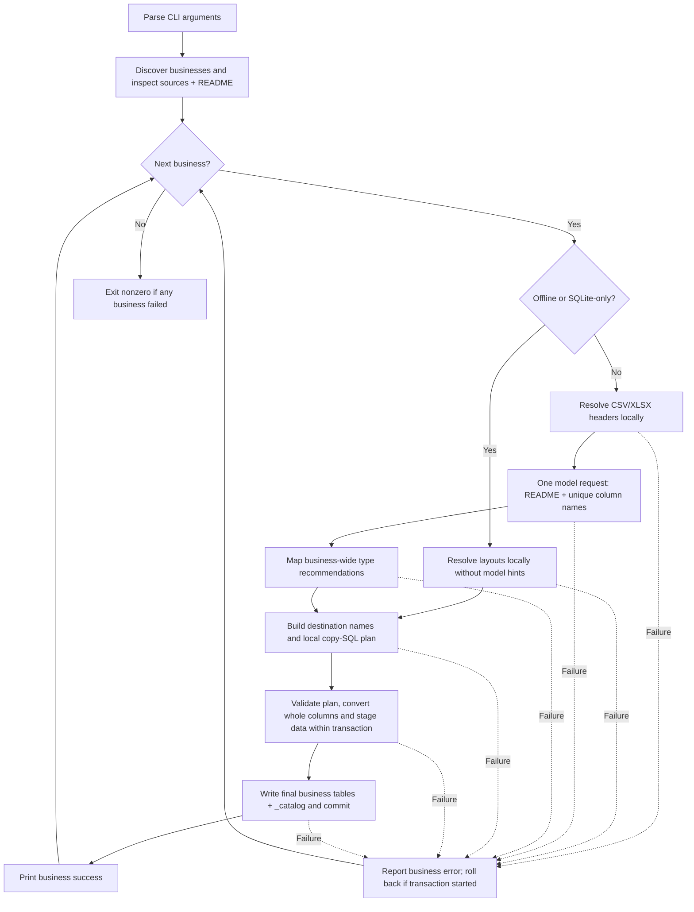

# Business import flow

The `business_import` package turns business source files into queryable DuckDB tables and records their provenance in `_catalog`. Its model recommends column types; Python determines layouts, validates conversions, and generates the import SQL.

## Run

From the repository root:

```powershell
python -m business_import --business biz_101
python -m business_import --business biz_101 --offline
python -m business_import
```

- Default inputs: `data/train/data/<business_id>/` and `data/public_test/data/<business_id>/`.
- Supported sources: CSV, XLSX worksheets, and SQLite tables, plus the business `README.md`.
- Default output: `tmp/businesses.duckdb`.
- Override inputs with `--roots` and the database with `--db`.
- Online configuration: `MODEL_API_KEY`, optionally `MODEL_BASE_URL` and `MODEL_NAME`, loaded through the shared model client.

## End-to-end flow



## 1. Discover and inspect

`business_import/__main__.py:run` coordinates the pipeline. `sources.py` discovers business directories, reads their README, and inventories supported files, worksheets, and SQLite tables.

Business IDs become DuckDB schema names. A requested `--business` must exist in the configured roots; missing roots or an empty discovery result fail rather than silently doing nothing.

## 2. Resolve source layouts locally

For online CSV/XLSX imports, `_read_tables` reads the complete local grids. `layouts.py` identifies and validates headers using structural evidence and documented README labels.

- Header positions and the start of data are determined locally, not by the model.
- Report preambles are represented in layout metadata.
- Source columns are preserved; duplicate or blank labels receive usable local names.
- A narrowly supported all-text layout with no header evidence preserves every row under generated column names. Other ambiguous layouts fail rather than guess.
- Empty sources have explicit handling.

SQLite bypasses header detection. Homogeneous storage stays native where supported; mixed storage uses tagged text to avoid collapsing distinct source values.

Offline mode uses structural candidates without requesting model recommendations. It can reject layouts that online mode resolves with README evidence.

## 3. Request and map type recommendations

For an online business containing CSV/XLSX, `llm.py` makes one request using the full README and deduplicated original source/README column names. It does not separately send source records, file/sheet identities, or header positions. Anything already present in the README is included in that text.

The response supplies business-wide column type/format recommendations, not SQL. Raw responses are saved under ignored `llm_out/` files.

`_apply_recommendations` matches names using Unicode normalization, case folding, and collapsed whitespace, without file scopes or fuzzy aliases. A repeated name can receive the same recommendation across multiple sources. Conflicting recommendations retain text with warnings. Missing recommendations normally retain text; selected date-name keywords can trigger a locally validated TIMESTAMP attempt. Explicit VARCHAR is not overridden.

SQLite-only businesses skip this request. SQLite tables in mixed businesses do not contribute header names and retain their native storage policy.

## 4. Preserve metadata and validate conversions

`database.py` invokes `column_types.py` before loading final values. Conversions are whole-column: every value must be safe, or the column keeps its original storage and emits a warning.

Supported types include VARCHAR, BIGINT, DECIMAL, BOOLEAN, DATE, and TIMESTAMP. Parsing covers validated numeric grouping, VND notation, explicit date formats, local day-first/year-first dates, Excel serial dates, and worksheet-period context for supported yearless dates. Parsing does not evaluate expressions. Leading-zero identifiers, overflow, ambiguous dates, or unsafe precision can prevent conversion.

Not every physical source row becomes a table record:

- Exact repetitions of the complete CSV/XLSX header are excluded and counted.
- Contiguous trailing XLSX notes explicitly labeled `Ghi chú:` or `Note:`, with other cells blank, move to catalog metadata.
- Under strict date-validation conditions, one final text-outlier row can be excluded and preserved in metadata.
- Interior/ambiguous notes, null records, and partial header matches are not generally discarded.

## 5. Generate local SQL and load transactionally

`sql.py` builds a one-to-one copy plan from staged tables to final schema-qualified destinations. Destination names derive from source files and, for XLSX/SQLite, worksheet/table names; collisions receive suffixes.

`database.py` validates that plan and loads one business in a transaction:

1. Check schema/table ownership and prepare the catalog.
2. Stage validated values in temporary tables.
3. Replace importer-owned final tables using the locally generated plan.
4. Write README, descriptions, source mappings, row counts, actual types, and warnings to `_catalog.businesses` and `_catalog.tables`.
5. Commit; roll back on failure.

Only final business tables persist, without duplicate raw tables. Imports do not join business tables. Unrelated/unowned tables are not overwritten.

## Outputs and failure behavior

Each business prints a JSON success result or an error. A failed business does not stop later businesses; any failure makes the command exit nonzero.

The resulting database and `_catalog` form the input contract for the [SQL generation and answering flow](../generate_sql/flow.md). The question pipeline uses the imported README snapshot and actual schema, not a fresh interpretation of the source files.

## Checks

```powershell
python -m unittest discover -s tests -p "test_business_import.py" -v
python -m unittest discover -s tests -p "test_column_types.py" -v
python -m unittest discover -s tests -p "test_readme_import.py" -v
```

Tests use temporary fixtures and mocked model responses; no dataset or API access is required.
