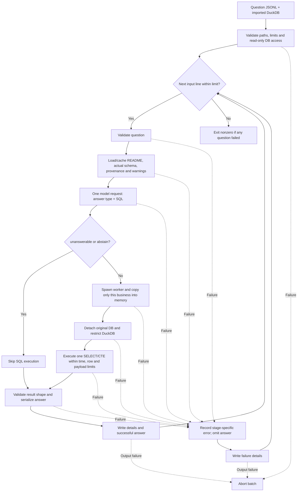

# SQL generation and answering flow

The `question_sql` package reads questions, asks the model for an answer type and DuckDB query, executes eligible queries locally, and writes formatted answers. It depends on a database produced by the [business import flow](../business_import/flow.md).

## Run

From the repository root, after importing the required businesses:

```powershell
python -m question_sql --questions data/train/questions.jsonl --output tmp/train_answers.jsonl --limit 5
python -m question_sql --questions data/public_test/questions.jsonl --output tmp/public_answers.jsonl
python -m question_sql --help
```

- Default database: `tmp/businesses.duckdb`; override with `--db`.
- Required arguments: `--questions` and `--output`.
- Optional diagnostics path: `--details`; otherwise `<output stem>.details.jsonl`.
- Both output paths must be new; existing files are never overwritten. Their parent directories must already exist.
- Model settings reuse the importer client: `MODEL_API_KEY`, optionally `MODEL_BASE_URL` and `MODEL_NAME`.
- Close DBeaver or other database connections if DuckDB reports a file lock.

## End-to-end flow



## 1. Validate batch inputs

`question_sql/__main__.py` parses CLI options and calls `runner.py:run`.

The runner checks positive limits, distinct input/database/output paths, absence of existing output files, and read-only database access before opening the outputs. Output files use exclusive creation, not overwrite mode.

`--limit` caps input lines, not successful answers. A malformed line still consumes a position in that limit.

## 2. Validate each question

`context.py:validate_question` requires an object with nonempty string fields:

```json
{
  "id": "q_example",
  "business_id": "biz_101",
  "question": "What is the total revenue?",
  "as_of_date": "2026-01-31"
}
```

It validates the schema-name format, calendar date, Unicode, and finite JSON values. Relative dates must be interpreted against `as_of_date`, not the current machine date.

## 3. Build trusted database context

`context.py:load_context` reads the imported business from `_catalog` and checks that it has loaded status and a nonempty README. It verifies that catalog mappings match the actual business tables and rejects unsupported views or missing columns.

The context includes:

- The complete imported README snapshot.
- Every actual destination table, column name, and DuckDB type.
- Source file and worksheet/table mappings.
- Import warnings.

The runner caches this context per business for the batch. It does not read training answers or send source records to the model.

## 4. Generate SQL and choose answer type

`llm.py:generate_sql` makes one structured model request. The payload combines the question, business ID, `as_of_date`, reference DDL using actual quoted names, and business context.

The response must contain exactly `type` and `sql`:

```json
{"type":"number","sql":"SELECT COUNT(*) FROM \"biz_101\".\"ban_hang\""}
```

Supported types are `number`, `percent`, `string`, `boolean`, `date`, `list`, `table`, `unanswerable`, and `abstain`. Percent means percentage points.

- `unanswerable`: required data is unavailable; SQL must be null.
- `abstain`: the model cannot confidently determine a correct query; SQL must be null.
- Other types require a nonempty query string.

The prompt directs the model to use documented relationships and units, actual schema-qualified names, and `as_of_date`. These instructions are not proof that the resulting business logic is correct.

Truncated or invalid responses fail explicitly. The client disables automatic retries; there is no model repair call or second model call to format results.

## 5. Execute in a separate worker

For answerable results, `execution.py:execute_sql` starts a process using multiprocessing `spawn`.

The worker:

1. Opens the original database read-only and validates business context.
2. Creates an in-memory DuckDB and copies only the requested business's tables.
3. Detaches the original database.
4. Disables external access, extension autoload/install, and disk spilling; locks configuration.
5. Parses the model SQL and permits exactly one SELECT statement, including a SELECT using a CTE.
6. Fetches at most the row limit plus one, so overflow raises an error instead of silently truncating.
7. Returns a size-bounded result to the parent process.

Default limits:

| Limit | Default |
| --- | --- |
| Worker deadline, including copying | 60 seconds (`--timeout`) |
| Result rows | 10,000 (`--max-rows`) |
| DuckDB memory | 256 MiB |
| Result payload | 16 MiB |

On timeout, the parent terminates the worker. Large businesses can exceed copying or memory limits before SQL finishes. This is defense in depth, not a hardened OS sandbox; DuckDB's memory setting does not bound all Python allocations.

## 6. Format and write outputs

`answers.py:format_answer` checks the executed result against the model-selected type:

- Scalars require exactly one row and one column, with the appropriate value type.
- Lists require one result column.
- Tables contain `columns` and `rows`.
- Dates use `YYYY-MM-DD`; native dates/times in lists and tables use ISO strings.
- Exact decimals serialize as JSON numbers without a binary-float round trip.

Successful answers contain `id`, `type`, and `answer`, without `alias`. `unanswerable` and `abstain` contain only `id` and `type`:

```json
{"id":"q_example","type":"number","answer":42}
{"id":"q_missing","type":"unanswerable"}
{"id":"q_uncertain","type":"abstain"}
```

The details JSONL records the original input, line number, selected type, SQL, result columns/rows, status, and stage-specific errors. It can contain business records and should be handled accordingly. Diagnostics serialize decimals as strings to preserve their representation; answer decimals remain JSON numbers.

## Failure behavior

Question-level failures are recorded with an `input`, `context`, `model`, `execution`, or `serialization` stage. The failed question is omitted from the answer file; it is not disguised as `unanswerable`. Later questions continue, and the batch exits nonzero if any question failed.

Output-writing failures abort the batch rather than being swallowed as question failures. Answer and details files are flushed incrementally, so an interrupted run can leave partial files; rerunning requires new output paths.

Successful execution proves neither the correctness of a join nor the intended aggregation, unit interpretation, or date cutoff. Review generated SQL and diagnostics before relying on results.

## Checks

```powershell
python -m unittest discover -s tests -p "test_question_sql.py" -v
```

Tests use temporary databases and mocked model responses; no dataset or API access is required.
