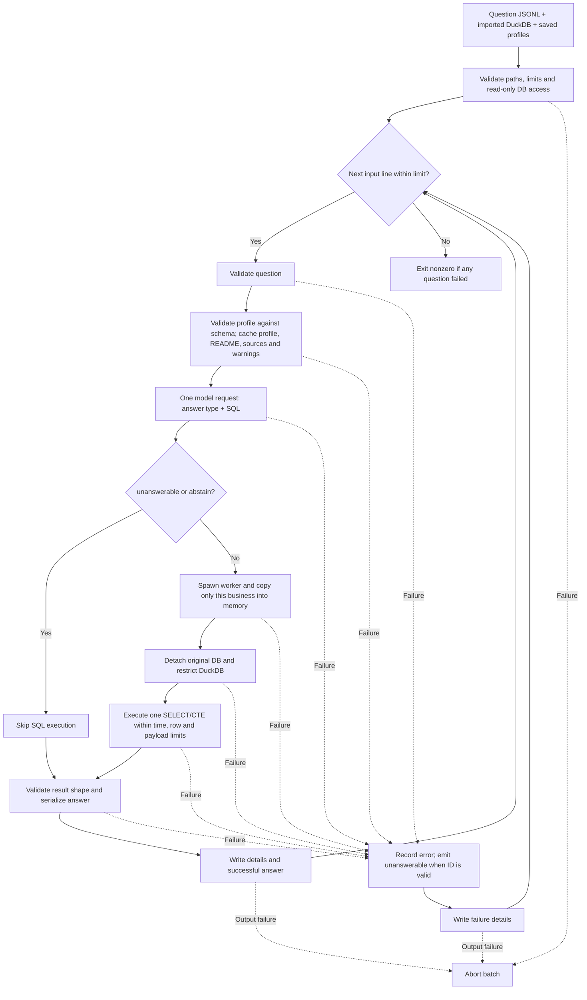

# SQL generation and answering flow

The `question_sql` package reads questions, asks the model for an answer type and DuckDB query, executes eligible queries locally, and writes formatted answers. It depends on a database produced by the [business import flow](../business_import/flow.md).

## Run

From the repository root, after importing the required businesses, generate their profiles (omit `--business` for all loaded businesses):

```powershell
python -m business_profile --business biz_101
python -m question_sql --questions data/train/questions.jsonl --output tmp/train_answers.jsonl --limit 5
python -m question_sql --questions data/public_test/questions.jsonl --output tmp/public_answers.jsonl
python -m question_sql --help
```

For custom paths, pair profiler output with QA input:

```powershell
python -m business_profile --db tmp/custom.duckdb --output-dir tmp/custom_profiles
python -m question_sql --db tmp/custom.duckdb --profile-dir tmp/custom_profiles --questions data/train/questions.jsonl --output tmp/custom_answers.jsonl --limit 5
```

- Default database: `tmp/businesses.duckdb`; override with `--db`.
- Profiles default to `<resolved database parent>/business_profiles`; override with `--profile-dir`.
- Required arguments: `--questions` and `--output`.
- Optional diagnostics path: `--details`; otherwise `<output stem>.details.jsonl`.
- Both output paths must be new; existing files are never overwritten. Their parent directories must already exist.
- Model settings reuse the importer client: `MODEL_API_KEY`, optionally `MODEL_BASE_URL` and `MODEL_NAME`.
- Close DBeaver or other database connections if DuckDB reports a file lock.

## End-to-end flow



## 1. Validate batch inputs

`question_sql/__main__.py` parses CLI options and calls `runner.py:run`.

The runner checks positive limits, distinct input/database/output paths, absence of existing output files, and read-only database access before opening the outputs. Output files use exclusive creation, not overwrite mode.

`--limit` caps input lines, not successful answers. A malformed line still consumes a position in that limit.

## 2. Validate each question

`context.py:validate_question` requires an object with nonempty string fields:

```json
{
  "id": "q_example",
  "business_id": "biz_101",
  "question": "What is the total revenue?",
  "as_of_date": "2026-01-31"
}
```

It validates the schema-name format, calendar date, Unicode, and finite JSON values. Relative dates must be interpreted against `as_of_date`, not the current machine date.

## 3. Build trusted database context

`context.py:load_context` reads the imported business from `_catalog` and checks that it has loaded status and a nonempty README. It verifies that catalog mappings match the actual business tables and rejects unsupported views or missing columns.

The context includes:

- The complete imported README snapshot.
- The full saved business profile, checked against every actual table and ordered column name/type.
- Source file and worksheet/table mappings.
- Import warnings.

Missing, malformed, legacy-extra-field or schema-mismatched profiles fail at context stage with a regeneration command before any model request. Grouped `names` entries retain combined UNION ALL statistics/domains, not per-table facts or join instructions. Unknown fields are rejected rather than forwarded.

The runner caches this context per business for the batch. No transaction data queries, automatic profiling or training-answer reads occur here. Rerun profiles manually after reimport/data changes and use separate directories per database; same-schema stale/cross-database profiles cannot be detected without source/freshness identity.

## 4. Generate SQL and choose answer type

`llm.py:generate_sql` makes one structured model request. Its flat payload contains `question`, `business_id`, `as_of_date`, `date_boundaries`, `readme`, `business_profile`, `sources` and `warnings`. Python recomputes today/yesterday/last-week/as-of boundaries for each question, even with cached business context. No duplicate DDL/schema or live status-label lookup is included.

The full validated profile (including actual bounded category labels), README, source mappings and warnings reach the configured endpoint. No transaction samples or gold answers are added. Review the input for sensitive content: the profiler's name-based exclusions are not guaranteed PII detection. Its existing category allowlist remains a coverage limitation, not arbitrary-column semantic discovery.

The response must contain exactly `type` and `sql`:

```json
{"type":"number","sql":"SELECT COUNT(*) FROM \"biz_101\".\"ban_hang\""}
```

Supported types are `number`, `percent`, `string`, `boolean`, `date`, `list`, `table`, `unanswerable`, and `abstain`. Percent means percentage points.

- `unanswerable`: required data is unavailable; SQL must be null.
- `abstain`: the model cannot confidently determine a correct query; SQL must be null.
- Other types require a nonempty query string.

The English prompt requests single-line SQL and exact Vietnamese names/labels. Status literals must be copied character-for-character from the relevant profile domain, preserving capitalization, accents and whitespace (only SQL quote escaping is allowed); case-insensitive matching is not a substitute. It distinguishes today (`hnay`) from yesterday and calendar quarters (`quy`) from months, requests distinct order counts rather than quantity sums, and avoids unnecessary lookup joins or unused CTEs. `business_profile` is metadata, not a SQL schema. It asks the model to first identify the question's target outcome, then classify observed statuses as DONE, IN_PROGRESS or CANCEL and select matching labels. Ordinary sales metrics default to DONE unless the question/README says otherwise; narrower requests such as returns do not include every CANCEL label. Item-line average order value uses SUM(amount) / COUNT(DISTINCT order ID), not AVG(amount) divided again. These are instructions within the same request, not extra model calls or proof that the resulting business logic is correct.

Truncated or invalid responses fail explicitly. The client disables automatic retries; there is no model repair call or second model call to format results.

## 5. Execute in a separate worker

For answerable results, `execution.py:execute_sql` starts a process using multiprocessing `spawn`.

The worker:

1. Opens the original database read-only and revalidates catalog/schema ownership independently of profile files.
2. Creates an in-memory DuckDB and copies only the requested business's tables.
3. Detaches the original database.
4. Disables external access, extension autoload/install, and disk spilling; locks configuration.
5. Parses the model SQL and permits exactly one SELECT statement, including a SELECT using a CTE. Only after a parser error, it may remove one trailing `}` or fix a mismatched closing identifier quote before `=` when DuckDB's final identifier token matches exactly one catalog column name. It reparses the candidate; the corrected query must still be exactly one SELECT. These are narrow single-artifact corrections, not general SQL repair. Valid SQL (including struct braces and string literals) is unchanged. Details retain the original `sql` and add `executed_sql` when a corrected query succeeds; no extra model request is made.
6. Fetches at most the row limit plus one, so overflow raises an error instead of silently truncating.
7. Returns a size-bounded result to the parent process.

Default limits:

| Limit | Default |
| --- | --- |
| Worker deadline, including copying | 60 seconds (`--timeout`) |
| Result rows | 10,000 (`--max-rows`) |
| DuckDB memory | 256 MiB |
| Result payload | 16 MiB |

On timeout, the parent terminates the worker. Large businesses can exceed copying or memory limits before SQL finishes. This is defense in depth, not a hardened OS sandbox; DuckDB's memory setting does not bound all Python allocations.

## 6. Format and write outputs

`answers.py:format_answer` checks the executed result against the model-selected type:

- Scalars require exactly one row and one column, with the appropriate value type.
- Lists require one result column.
- Tables contain `columns` and `rows`.
- Native timestamps in scalar, list and table answers become `YYYY-MM-DD`, dropping the time without timezone conversion. A scalar timestamp selected as `string` or `date` emits type `date`. Native dates also use `YYYY-MM-DD`; time-only values retain ISO time strings. Text is not guessed to be a timestamp; diagnostics retain full native timestamps.
- Scalar `number` answers round locally to integers (nearest integer, ties away from zero); `percent` rounds locally to two decimal places using the same tie rule. Numbers in lists/tables are unchanged. Exact decimals serialize without a binary-float round trip, and diagnostics retain unrounded results.

Successful answers contain `id`, `type`, and `answer`, without `alias`. Model `unanswerable`/`abstain` both emit `unanswerable` with a local `reason`:

```json
{"id":"q_example","type":"number","answer":42}
{"id":"q_missing","type":"unanswerable","reason":"Required data is unavailable."}
{"id":"q_uncertain","type":"unanswerable","reason":"Cannot determine a reliable answer."}
```

The details JSONL records the original input, line number, selected type, SQL, result columns/rows, status, and stage-specific errors. It can contain business records and should be handled accordingly. Diagnostics serialize decimals as strings to preserve their representation; answer decimals remain JSON numbers.

## Failure behavior

Question-level failures are recorded with an `input`, `context`, `model`, `execution`, or `serialization` stage. A failed question with a valid nonempty Unicode ID emits `{id, type: "unanswerable", reason}` with a stage-specific explanation; inputs without usable IDs remain details-only. Original error/status stays in details. Later questions continue, and the batch exits nonzero if any question failed.

Output-writing failures abort the batch rather than being swallowed as question failures. Answer and details files are flushed incrementally, so an interrupted run can leave partial files; rerunning requires new output paths.

Successful execution proves neither the correctness of a join nor the intended aggregation, unit interpretation, or date cutoff. Review generated SQL and diagnostics before relying on results.

## Checks

```powershell
python -m unittest discover -s tests -p "test_question_sql.py" -v
```

Tests use temporary databases and mocked model responses; no dataset or API access is required.
